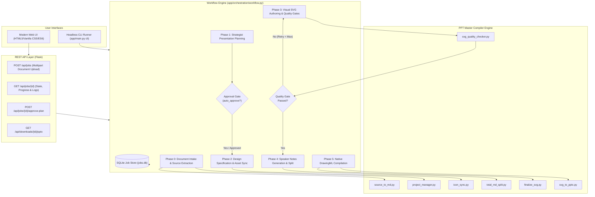

# PPT Master Standalone System Architecture & Delivery Guide

This document provides complete documentation for the transformation of **PPT Master** from an external agent-driven skill into a standalone, API-driven, document-to-PowerPoint generation application that operates independently at runtime.

---

## 1. Executive Summary & Objective

**PPT Master Standalone** eliminates runtime reliance on external AI agents (such as Antigravity, Claude Desktop, or bespoke coding agents) while 100% preserving the underlying generation capabilities, design contracts, and DrawingML OpenXML compilation engine.

The standalone system replaces agent manual tool invocations with:
1. **Deterministic Application Logic**: Automated document conversion (`source_to_md.py`), project structure setup (`project_manager.py`), icon syncing (`icon_sync.py`), notes splitting (`total_md_split.py`), and asset inlining (`finalize_svg.py`).
2. **Constrained AI Model API Integration**: Direct provider integration supporting **Azure OpenAI** and **standard OpenAI**, utilizing strongly-typed schemas (Pydantic) for document planning, design specifications, SVG slide generation, and targeted repair.
3. **Fail-Closed Quality Gates**: Preflight SVG validation, sanitizer filtering (stripping forbidden HTML tags, replacing illegal entities, cleaning whitespace), early validation gates after Slide 5, and final validation via `svg_quality_checker.py`.
4. **Self-Healing Repair Loop**: Bounded retries where validator diagnostics are fed back into targeted LLM repair prompts, ensuring slides pass before compilation.
5. **Decoupled User Interfaces**: Modern Web UI with interactive stage monitoring and plan approval modal, plus a headless CLI (`python app/main.py cli`).

---

## 2. Agent-to-Application Responsibility Mapping

| Agent Responsibility | Original Mechanism | Standalone Application Replacement | Output / Artifact |
| :--- | :--- | :--- | :--- |
| **Read repository instructions** | Agent read `AGENTS.md` and `SKILL.md` via IDE tools | `AppConfig` and centralized settings loader (`app/config.py`) | Validated configuration & paths |
| **Understand source document** | Agent parsed PDF/DOCX or ran `source_to_md.py` | `DocumentService` with MIME/extension validation and `source_to_md.py` dispatch | Clean Markdown in `sources/` |
| **Plan presentation** | Agent assumed "Strategist" role, solicited human approval via `ask_question` | `PlanningService` with structured Pydantic schemas (`PresentationPlan`, `SlidePlan`) and optional approval gate | `presentation_plan.json` |
| **Author design contracts** | Agent manually wrote `design_spec.md` & `spec_lock.md` | `PlanningService._render_design_spec_md` and `_render_spec_lock_md` | Validated `design_spec.md` and `spec_lock.md` |
| **Prepare vector assets** | Agent selected icons and called `icon_sync.py` | `AssetService` syncing icons via `icon_sync.py` and processing image manifests | `icons/` synced SVGs and `images/` |
| **Generate slide visuals** | Agent assumed "Executor" role, wrote SVG per slide | `SlideService` invoking AI client with `SLIDE_SVG_USER_PROMPT` | `svg_output/slide_*.svg` |
| **Enforce quality gates** | Agent ran `svg_quality_checker.py`, inspected stdout | `ValidationService` preflight checks + automated `svg_quality_checker.py` runner | `validation/svg_quality_report.json` |
| **Repair invalid slides** | Agent diagnosed error lines, edited SVGs | `SlideService.repair_existing_slide` with bounded retry loop (default: 3) | Repaired, compliant SVGs |
| **Author speaker notes** | Agent authored `notes/total.md` and ran `total_md_split.py` | `NotesService` generating structured notes and dispatching `total_md_split.py` | `notes/total.md` and `notes/slide_*.md` |
| **Compile & Export** | Agent ran `finalize_svg.py` and `svg_to_pptx.py` | `ExportService` running `finalize_svg.py` and `svg_to_pptx.py --quick-generate` | Editable native OpenXML `.pptx` |

---

## 3. System Architecture & Data Flow



---

## 4. Key Subsystems and Implementation Details

### 4.1 Document Ingestion (`app/services/document_service.py`)
- Supported input formats: PDF, DOCX, DOC, PPTX, XLSX, CSV, TSV, TXT, MD, HTML.
- Format verification and file-size enforcement (configured via `UPLOAD_MAX_SIZE_MB`).
- Seamless invocation of `skills/ppt-master/scripts/source_to_md.py`, converting source documents into structured Markdown placed in `sources/`.

### 4.2 AI Provider Layer (`app/ai/client.py`)
- **`BaseAIClient`**: Abstract interface providing typed methods `generate_text()`, `generate_plan()`, `generate_design_spec()`, `generate_slide_svg()`, `repair_slide_svg()`, and `generate_speaker_notes()`.
- **`AzureOpenAIClient`**: Full support for Azure OpenAI deployments with exponential backoff on HTTP 429 rate limits, request timeouts, and structured JSON parsing.
- **`OpenAIClient`**: Support for OpenAI API endpoints and compatible alternatives.
- **`MockAIClient`**: Offline mock provider allowing fully deterministic unit and integration testing without network or credentials.

### 4.3 Slide Quality Control and Self-Healing (`app/services/validation_service.py` & `slide_service.py`)
- **Fast Preflight Check**: Detects prohibited HTML entities (`&bull;`, `&mdash;`), forbidden tags (`<style>`, `<foreignObject>`, `<script>`), CSS `class` attributes, and XML syntax errors before writing to disk.
- **Automatic Sanitizer**: Replaces HTML entities with valid XML/Unicode, strips forbidden elements, cleans base64 whitespace.
- **Early Quality Gate**: Executed automatically after Slide 5 when generating decks with >6 slides to catch style or coordinate drift early.
- **Final Quality Gate**: Runs `svg_quality_checker.py --stage final --json --canonical-authoring`.
- **Targeted Repair**: Isolates error coordinates and diagnostic messages, passing them to the AI repair prompt without altering valid neighboring elements.

### 4.4 Presentation Compilation (`app/services/export_service.py`)
- Invokes `finalize_svg.py` to inline all vector icon definitions and embed raster assets.
- Executes `svg_to_pptx.py` with `--quick-generate` and `--with-notes`.
- Slide dimensions strictly preserved (1280x720 px for 16:9 widescreen).
- Every card, pill, text block, and icon remains 100% natively editable DrawingML in PowerPoint, Keynote, and Google Slides.

---

## 5. Local Execution & Usage

### 5.1 Installation & Configuration
```bash
# 1. Activate virtual environment
source .venv/bin/activate

# 2. Configure credentials in .env
cp .env.example .env
# Edit .env and supply your Azure OpenAI or OpenAI credentials:
# AI_PROVIDER=azure_openai
# AZURE_OPENAI_ENDPOINT=https://your-resource.openai.azure.com/
# AZURE_OPENAI_API_KEY=your-api-key
# AZURE_OPENAI_DEPLOYMENT=gpt-4o-mini
```

### 5.2 Running via Web Interface
```bash
python app/main.py server --port 5000
```
Open your browser to `http://127.0.0.1:5000`:
- Drag and drop source documents (PDF, DOCX, TXT, Markdown).
- Configure presentation parameters (Topic, Purpose, Audience, Slide Budget, Visual Theme).
- Toggle Auto-Approval or review the structured plan interactively before slide generation.
- Monitor real-time stage progression and download the compiled `.pptx` presentation.

### 5.3 Running via Headless CLI
```bash
python app/main.py cli \
  --source samples/proposal.docx \
  --name "Enterprise_Cloud_Strategy" \
  --slides 5 \
  --purpose "Executive Strategy Briefing" \
  --audience "C-Level Leadership" \
  --style "Modern Clean Dark"
```

### 5.4 Running Automated Verification Suite
```bash
python -m unittest discover tests
```
Executes all 53 unit, integration, and behavioral regression tests in ~30 seconds with 100% pass rate.
